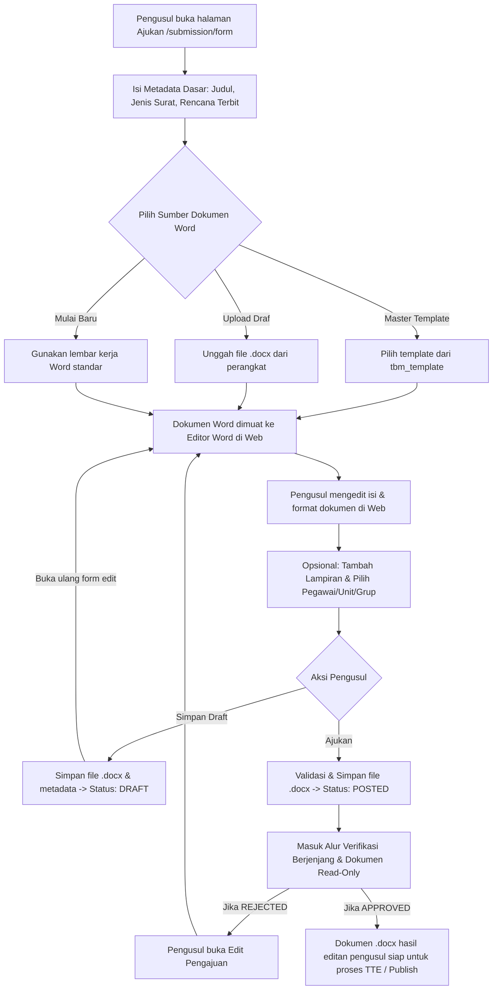

# PRODUCT REQUIREMENTS DOCUMENT (PRD)
## Halaman Ajukan Pengusul dengan Editor Word Terintegrasi (Web-Based Word Editor) — Aplikasi Pengelolaan Surat Polibatam

| Informasi Dokumen | Keterangan |
| :--- | :--- |
| **Versi** | 1.0 — Draft Spesifikasi Kebutuhan |
| **Tanggal** | 25 November 2026 |
| **Pemilik Kebutuhan** | Klien / Urusan Administrasi & Pengusul (Dosen/Staff) Polibatam |
| **Penyusun** | Tim PBL — Pengelolaan Surat Polibatam |
| **Status** | **Siap Direview & Diturunkan ke Sprint Backlog** |

---

### Tujuan Dokumen
Mendefinisikan kebutuhan produk, alur pengguna, spesifikasi antarmuka, serta desain teknis pembaruan **Halaman Ajukan Pengusul** (`/submission/form`) agar pengguna (Dosen/Staff) dapat langsung **membuka, menyesuaikan, dan mengedit dokumen berformat Word (`.docx`) secara langsung di dalam aplikasi web** sebelum diajukan ke alur verifikasi berjenjang.

---

## 1. Latar Belakang & Hasil Pengujian Klien

Pada implementasi saat ini (`/submission/form`), pengusul hanya mengisi formulir terstruktur yang bersifat kaku (`title`, `type`, `pickup_plan`, `list_consider`, `list_observe`, dan `list_decide`). Dokumen Word (`.docx`) baru dibentuk secara otomatis di backend oleh `DocxTemplateService` pada saat pengajuan mencapai status akhir `APPROVED`.

Berdasarkan hasil pengujian langsung bersama klien, ditemukan kendala dan kebutuhan sebagai berikut:
1. **Keterbatasan Format pada Form Biasa**: Pengusul sering kali perlu mengatur isi surat secara lebih leluasa (misalnya menambah tabel susunan panitia, mengatur poin konsiderans/diktum dengan format khusus, atau menyesuaikan redaksi surat sesuai konteks kegiatan) yang sulit diakomodasi oleh input teks biasa.
2. **Keinginan Klien ("Tetap Ada Word di Webnya")**: Klien menginginkan agar di halaman Ajukan tersedia tampilan **editor Word langsung di web**, sehingga pengusul tetap dapat melihat wujud dokumen surat yang sebenarnya dan mengedit isinya secara langsung sesuai kebutuhan mereka tanpa harus keluar dari sistem atau menebak hasil akhir cetak.
3. **Efisiensi Proses Verifikasi**: Dengan dokumen Word yang sudah disusun dan dirapikan langsung oleh pengusul sejak tahap pengajuan, verifikator (Tahap 1–3) dapat langsung memeriksa substansi serta tata letak naskah yang utuh dan mengurangi revisi berulang.

---

## 2. Cakupan Produk (Scope)

### Termasuk (In-Scope):
- **Pemilihan Sumber Dokumen Word** di halaman Ajukan:
  1. Memilih **Master Template Resmi** dari daftar `tbm_template` aktif (SK Non-Honor, SK Honor, Perdir, Surat Tugas, dll.).
  2. Mengunggah draf `.docx` milik pengusul sendiri untuk langsung dibuka dan diedit lebih lanjut di web.
  3. Memulai dari dokumen kosong (*Blank Document*) dengan format standar surat Polibatam.
- **Editor Word Terintegrasi di Web** pada halaman `/submission/form`:
  - Pengusul dapat mengedit teks, paragraf, daftar bernomor/poin, tabel, perataan teks, dan struktur isi dokumen secara visual (WYSIWYG).
  - Tersedia kontrol simpan ke server (`DRAFT` maupun `POSTED`), unduh salinan `.docx`, serta mode layar penuh (*fullscreen*) agar nyaman saat menyunting naskah panjang.
- **Penyimpanan & Sinkronisasi Dokumen `.docx`**:
  - Hasil editan pengusul disimpan langsung sebagai berkas `.docx` pada `tbl_submission.filepath`.
  - Pengajuan berstatus `DRAFT` atau `REJECTED` dapat dibuka kembali di `/submission/form?submission_id=...` dengan memuat isi dokumen Word terakhir yang telah diedit.
- **Pratinjau Dokumen (*Read-Only*)**:
  - Ketika status menjadi `POSTED`, `APPROVED`, atau `PUBLISHED`, pengusul tidak lagi dapat mengedit isi dokumen Word; dokumen ditampilkan dalam mode baca (*read-only*) pada halaman detail (`/submission/[id]`) untuk pengusul maupun verifikator.
- **Metadata & Lampiran Pendukung**:
  - Pengusul tetap mengisi metadata wajib (`title`, `type`, `pickup_plan`), opsi lampiran pendukung (`is_attachment` / `filepath_attachment`), serta penentuan pegawai/unit/grup terkait (`users`, `units`, `groups`).

### Di Luar Cakupan (Out-of-Scope):
- Kolaborasi penyuntingan *real-time* multi-pengguna dalam satu waktu (concurrent cursor ala Google Docs).
- Penandatanganan TTE digital langsung di dalam kanvas editor Word (penerbitan berkas bertanda tangan resmi tetap melalui tahap `APPROVED` → `PUBLISHED`).
- Migrasi atau konversi otomatis dokumen arsip lama yang sudah berstatus `PUBLISHED`.

---

## 3. Aktor & Hak Akses

| Peran | Hak Akses & Tanggung Jawab pada Fitur Ini |
| :--- | :--- |
| **Pengusul (Dosen / Staff)** | Membuka halaman Ajukan, memilih template atau mengunggah draf `.docx`, mengedit dokumen Word secara langsung di web, menyimpan `DRAFT`, mengirim pengajuan (`POSTED`), dan memperbaiki isi dokumen Word jika status `REJECTED`. |
| **Admin / Urusan Administrasi** | Mengelola daftar Master Template `.docx` (`tbm_template`) yang tersedia di halaman Ajukan, meninjau dokumen Word hasil editan pengusul pada halaman detail, serta menerbitkan SK final (`PUBLISHED`). |
| **Verifikator (Tahap 1–3)** | Melihat pratinjau dokumen Word hasil editan pengusul secara *read-only* di halaman detail/verifikasi tanpa mengubah naskah, lalu melakukan aksi `APPROVE` atau `REJECT` beserta catatan revisi. |

---

## 4. Alur Kerja Halaman Ajukan (Workflow)



---

## 5. Tata Letak Antarmuka & Kebutuhan Fungsional UI/UX

Halaman `/submission/form` dirancang tetap selaras dengan komponen Vuexy/Vuetify yang sudah ada, dengan pembaruan struktur sebagai berikut:

1. **Sticky Header Aksi (Bagian Atas)**:
   - Judul halaman (`Form Pengajuan Surat`) beserta indikator status saat mode edit (`DRAFT` / `REJECTED`).
   - Tombol aksi utama:
     - `Kembali` (menuju `/submission`).
     - `Simpan Sebagai Draft` (menyimpan progres dokumen Word dan metadata dengan status `DRAFT`).
     - `Ajukan` (memvalidasi kelengkapan data & isi dokumen Word, lalu mengirim pengajuan dengan status `POSTED`).
2. **Panel Informasi Utama Pengajuan**:
   - `Judul Surat` (`title`, wajib).
   - `Jenis Surat` (`type`: `SK Honor`, `SK Non-Honor`, `Perdir`, `Surat Tugas`, wajib).
   - `Tanggal Terbit / Rencana Pengambilan` (`pickup_plan`, wajib).
   - `Sumber Template / Dokumen Word`:
     - Dropdown pilihan Master Template (`tbm_template` aktif, difilter sesuai `type` atau semua).
     - Tombol `Unggah File .docx` sebagai alternatif bila pengusul sudah menyiapkan file Word lokal.
     - Tombol `Reset ke Template Awal` (dengan dialog konfirmasi agar perubahan pengusul tidak hilang tidak sengaja).
3. **Area Utama: Editor Word di Web (*Web Word Workspace*)**:
   - Ditempatkan sebagai panel utama yang lega (minimal tinggi ~650px, mendukung tombol **Layar Penuh / Fullscreen**).
   - Menampilkan dokumen menyerupai lembar kerja Microsoft Word lengkap dengan toolbar pemformatan (font, ukuran huruf, *bold/italic/underline*, perataan paragraf, *bullet & numbering*, penyisipan/edit tabel, *undo/redo*).
   - Menampilkan indikator status penyimpanan dokumen (mis. *Tersimpan otomatis* / *Ada perubahan belum disimpan*).
   - Menyediakan tombol `Unduh Draf (.docx)` jika pengusul ingin menyimpan salinan lokal.
   - **Catatan kompatibilitas form lama**: Bagian input `Menimbang / Mengingat / Menetapkan` yang kaku tidak lagi menjadi kewajiban utama jika dokumen sudah disusun langsung di Editor Word (dapat disembunyikan atau dijadikan opsional/pembantu pengisian template).
4. **Panel Lampiran & Data Pendukung (Bagian Bawah)**:
   - Switch `Apakah ada lampiran pendukung?` + input file lampiran (`filepath_attachment`, misalnya PDF pendukung SK/rab/daftar hadir).
   - Expansion panels eksisting untuk memilih **Pegawai** (`users`), **Unit** (`units`), dan **Grup** (`groups`).

---

## 6. Keputusan Arsitektur Editor Word di Web

Untuk mewujudkan kebutuhan **"tetap ada Word di webnya"** pada stack aplikasi saat ini (**Vue 3 + Vuetify** di frontend dan **Express.js + TypeScript + Prisma + PostgreSQL** di backend), berikut dua opsi arsitektur beserta keputusan rekomendasinya:

| Aspek | Opsi A: Document Server Self-Hosted (ONLYOFFICE Docs / Collabora Online) — **Direkomendasikan** | Opsi B: Editor Rich-Text Browser (`@tiptap/vue-3` / SuperDoc) + Konversi `.docx` |
| :--- | :--- | :--- |
| **Fidelitas Tampilan Word** | **Sangat Tinggi (~100% identik MS Word)**: kop surat, margin A4, header/footer, tabel, dan penomoran tampil persis seperti Word asli. | **Sedang**: menggunakan editor HTML (`@tiptap/vue-3` sudah ada di `package.json`), namun tata letak margin/header kompleks berpotensi bergeser saat konversi `.docx ↔ HTML`. |
| **Format Penyimpanan** | Membaca & menyimpan langsung file `.docx` asli di server tanpa konversi dua arah yang merusak format. | Membutuhkan library konverter (mis. `mammoth` untuk baca, `docx` / HTML-to-docx untuk ekspor) atau editor `.docx` khusus berbasis client-side. |
| **Infrastruktur** | Memerlukan 1 service container Docker tambahan (ONLYOFFICE Document Server) yang terhubung ke backend Express lewat callback URL. | Tidak perlu server tambahan; berjalan langsung di bundle Vite/Vue frontend dan backend Node.js. |
| **Keputusan Implementasi** | **Prioritas Utama (Produksi/Klien)** jika server deployment mendukung Docker container Document Server. | **Alternatif / Fallback Cepat** jika deployment dibatasi hanya pada Node.js + PostgreSQL tanpa container tambahan. |

### Aturan Kompatibilitas Data & Backend:
1. **Format File Kanonik adalah `.docx`**: Apa pun editor yang dipakai di frontend (Opsi A maupun Opsi B), hasil akhir yang disimpan ke backend saat `Simpan Draft` atau `Ajukan` harus berupa berkas `.docx` yang tersimpan path-nya di `tbl_submission.filepath`.
2. **Jangan Timpa Dokumen Hasil Edit Pengusul saat `APPROVED`**:
   - Pada kode backend saat ini (`backend/app/submission/submission.Repository.ts`), status `APPROVED` memanggil `DocxTemplateService.submissionApproved(...)` yang menimpa `filepath` memakai template default.
   - **Perubahan wajib**: Jika pengajuan sudah memiliki berkas `.docx` yang diedit/diunggah oleh pengusul (`tbl_submission.filepath` terisi), proses persetujuan akhir (`APPROVED`) **harus mempertahankan berkas `.docx` tersebut** sebagai dokumen resmi siap TTE/unduh tanpa menimpanya dengan template lama.

---

## 7. Desain Database & Kontrak API

### A. Penyesuaian Skema Database (`prisma/schema.prisma`)
Struktur `tbl_submission` dan `tbm_template` di `prisma/schema.prisma` sebagian besar **sudah siap** (`filepath`, `template_id`, `template_values`). Penambahan minimal yang disarankan pada `tbl_submission`:

```prisma
model tbl_submission {
  // ... field eksisting ...
  document_source String?  @default("TEMPLATE") // "TEMPLATE" | "UPLOAD" | "BLANK"
  editor_content  String?  @db.Text             // Opsional: snapshot HTML/JSON jika memakai Opsi B
}
```

### B. Penyesuaian Validasi & Endpoint Backend

| Method & Endpoint | Status Saat Ini | Perubahan / Kebutuhan Baru |
| :--- | :--- | :--- |
| `GET /api/v1/templates?is_active=true` | Sudah ada | Digunakan halaman Ajukan untuk memuat pilihan Master Template `.docx`. |
| `GET /api/v1/templates/:id/download` | Perlu ditambah | Mengirim file `.docx` template asli secara aman agar dapat dimuat ke Editor Word di web atau diunduh pengusul. |
| `POST /api/v1/submission/draft-document` | Perlu ditambah | Menerima unggahan atau hasil ekspor `.docx` dari Editor Word (multipart `file`), menyimpannya ke storage (`public/submissions/...`), dan mengembalikan `filepath` untuk disimpan pada pengajuan. |
| `POST /api/v1/submission/:id/editor-callback` | Opsional (Opsi A) | Endpoint callback untuk ONLYOFFICE/Collabora agar otomatis menyimpan perubahan `.docx` dari editor web ke `tbl_submission.filepath`. |
| `POST /api/v1/submission` & `PUT /api/v1/submission/:id` | Perlu disesuaikan | Pada `SubmissionSchema` (`submission.Schema.ts`): `list_consider`, `list_observe`, dan `list_decide` tetap opsional/default `[]`; tambahkan validasi bahwa saat `status === "POSTED"`, `filepath` dokumen Word wajib sudah tersedia. |

---

## 8. Kriteria Penerimaan (Acceptance Criteria — *Given-When-Then*)

1. **Memilih Master Template & Mengedit Word di Web**
   - **Given** pengusul berada di halaman `/submission/form` dan telah mengisi Judul serta Jenis Surat,
   - **When** pengusul memilih salah satu template dari `tbm_template`,
   - **Then** isi dokumen Word dari template tersebut tampil di area Editor Word web dan pengusul dapat langsung mengubah teks, paragraf, maupun tabel sesuai keinginannya.

2. **Mengunggah Draf `.docx` Sendiri untuk Diedit di Web**
   - **Given** pengusul sudah memiliki file `.docx` di perangkatnya,
   - **When** pengusul mengunggah file tersebut melalui tombol unggah draf di halaman Ajukan,
   - **Then** dokumen `.docx` tersebut dimuat ke dalam Editor Word web sehingga dapat ditinjau dan disunting lebih lanjut sebelum disimpan atau diajukan.

3. **Menyimpan Draft & Melanjutkan Pengeditan**
   - **Given** pengusul telah mengedit dokumen Word di halaman Ajukan,
   - **When** pengusul menekan tombol **Simpan Sebagai Draft**,
   - **Then** pengajuan tersimpan dengan status `DRAFT` beserta file `.docx` terbaru, dan ketika pengusul membuka kembali form edit, isi dokumen Word terakhir yang tersimpan muncul kembali untuk diedit.

4. **Mengajukan Surat (`POSTED`) & Perlindungan Naskah**
   - **Given** pengusul selesai menyunting dokumen Word di web dan menekan tombol **Ajukan**,
   - **When** pengajuan berhasil disimpan dengan status `POSTED`,
   - **Then** dokumen `.docx` hasil editan pengusul tersimpan sebagai naskah aktif, pengusul tidak dapat lagi mengedit dokumen selama proses verifikasi berlangsung, dan verifikator dapat melihat isi dokumen tersebut secara *read-only* di halaman detail.

5. **Revisi Pengajuan yang Ditolak (`REJECTED`)**
   - **Given** pengajuan ditolak oleh verifikator dengan catatan revisi (`REJECTED`),
   - **When** pengusul membuka halaman edit pengajuan tersebut,
   - **Then** catatan penolakan tampil jelas dan Editor Word memuat naskah `.docx` terakhir agar pengusul dapat langsung memperbaiki bagian yang diminta lalu mengajukan ulang (`POSTED`).

6. **Integritas Dokumen Setelah Disetujui Final (`APPROVED`)**
   - **Given** seluruh tahap verifikasi telah menyetujui pengajuan (`APPROVED`),
   - **When** sistem memproses status akhir pengajuan,
   - **Then** berkas `.docx` yang telah disusun dan diedit oleh pengusul di web tetap dipertahankan sebagai berkas final untuk diunduh/diproses TTE oleh Admin tanpa tertimpa template kosong.

---

## 9. Rencana Implementasi Bertahap

1. **Backend**:
   - Tambah endpoint unduh template (`GET /api/v1/templates/:id/download`) dan unggah/simpan draf `.docx` (`POST /api/v1/submission/draft-document`, plus callback jika memakai ONLYOFFICE).
   - Sesuaikan `submission.Repository.ts` agar pengajuan yang sudah memiliki `filepath` `.docx` dari pengusul tidak ditimpa saat mencapai status `APPROVED`.
   - Tambah kolom opsional `document_source` (dan `editor_content` jika memakai Opsi B) di `prisma/schema.prisma`.
2. **Frontend (`/submission/form` & `/submission/[id]`)**:
   - Integrasikan komponen pemilihan template (`tbm_template`), unggah draf `.docx`, dan **Web Word Editor** pada `frontend/src/pages/submission/form.vue`.
   - Hubungkan aksi `Simpan Sebagai Draft` dan `Ajukan` agar menyimpan file `.docx` terbaru terlebih dahulu sebelum mengirim payload pengajuan.
   - Tambahkan penampil/pratinjau dokumen Word (*read-only*) pada `frontend/src/pages/submission/[id].vue` untuk pengusul dan verifikator.
3. **Pengujian**:
   - Uji seluruh skenario *Given-When-Then* di atas bersama pengusul dan tim verifikator (membuat dari template, unggah `.docx`, edit di web, simpan draft, ajukan, tolak & revisi, hingga `APPROVED`).
