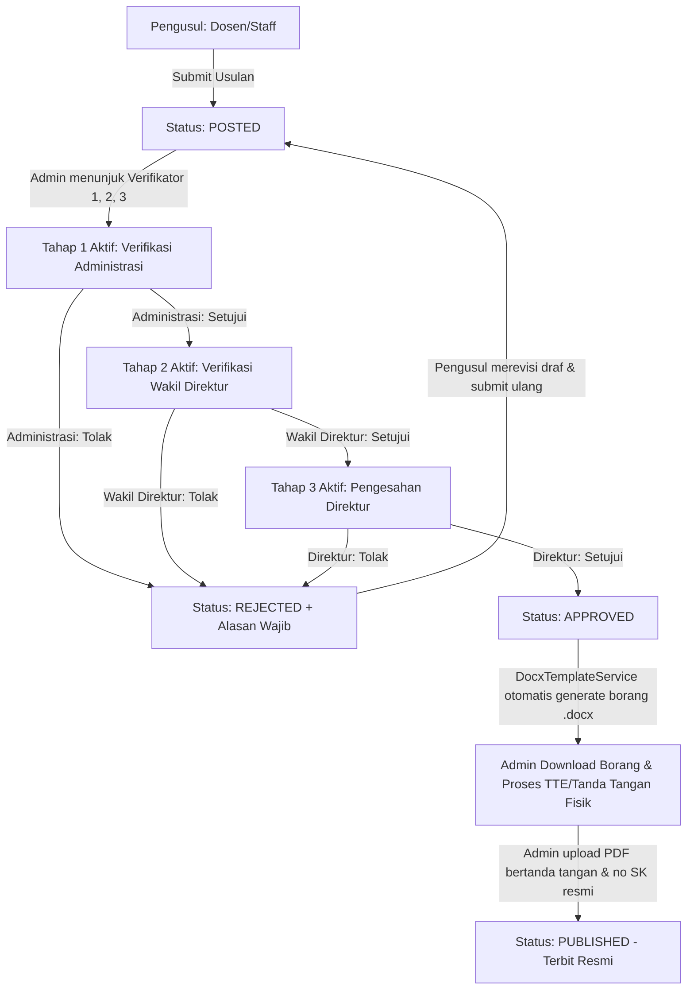

# PRODUCT REQUIREMENTS DOCUMENT (PRD)
## Verifikasi Surat Tiga Tahap — Aplikasi Pengelolaan Surat Polibatam

| Informasi Dokumen | Keterangan |
| :--- | :--- |
| **Versi** | 1.1 — Final Draft & Keputusan Arsitektur |
| **Tanggal** | 19 Oktober 2026 |
| **Pemilik Kebutuhan** | Urusan Administrasi Polibatam (Ibu Regina) |
| **Penyusun** | Tim PBL — Pengelolaan Surat Polibatam |
| **Status** | **Terkonfirmasi & Dijawab** (Siap diturunkan ke Backlog Teknis) |

---

### Tujuan Dokumen
Mendefinisikan kebutuhan produk dan arsitektur alur verifikasi pengajuan Surat Keputusan (SK) tiga tahap berurutan secara terpusat dan paperless, serta menjawab seluruh pertanyaan bisnis/teknis terbuka agar implementasi dapat dieksekusi dengan prinsip perubahan seminimal mungkin (*minimum complete change*).

---

## 1. Ringkasan Produk & Latar Belakang

Fitur **Verifikasi Tiga Tahap** memungkinkan pengajuan Surat Keputusan (SK) diproses secara berurutan (*sequential approval*) oleh 3 verifikator yang ditugaskan oleh Admin Urusan Administrasi untuk setiap pengajuan:
1. **Tahap 1**: Verifikasi Administrasi (Urusan Administrasi).
2. **Tahap 2**: Verifikasi Wakil Direktur (Wakil Direktur terkait).
3. **Tahap 3**: Pengesahan Direktur (Direktur Politeknik Negeri Batam).

### Masalah yang Diselesaikan:
- **Ketergantungan WhatsApp**: Menghilangkan proses manual "chat WA satu per satu" yang sering terlewat/lama.
- **Fleksibilitas Penugasan**: Nama/jabatan verifikator tidak boleh di-hardcode di kode program, melainkan dipilih oleh Admin sesuai jenis pengajuan dengan role yang sesuai.
- **Audit Trail & Notifikasi**: Rekam jejak siapa, kapan, keputusan (setujui/tolak), serta notifikasi terpusat di dalam aplikasi.

---

## 2. Cakupan Produk (Scope)

### Termasuk (In-Scope MVP):
- Form penugasan verifikator tahap 1 (Administrasi), tahap 2 (Wakil Direktur), dan tahap 3 (Direktur) oleh Admin saat pengajuan diproses.
- Alur verifikasi sekuensial (Tahap 2 hanya aktif setelah Tahap 1 disetujui; Tahap 3 hanya aktif setelah Tahap 2 disetujui).
- Aksi **Setujui** dan **Tolak** (Penolakan wajib menyertakan alasan).
- Penguncian naskah pengajuan (*Read-Only*) selama verifikasi berlangsung.
- Alur perbaikan: Jika ditolak, pengaju dapat mengedit dan mengajukan ulang (alur mengulang dari Tahap 1).
- Notifikasi *In-App* (lonceng navbar & daftar tugas verifikator).
- Riwayat audit lengkap di `tbl_submission_log`.

### Di Luar Cakupan (Out of Scope MVP):
- Integrasi server TTE digital otomatis (tanda tangan diproses di luar sistem/offline).
- Notifikasi email via SMTP server kampus.
- Editor dokumen Word online / web-based.

---

## 3. Hak Akses dan Aktor

| Peran | Tanggung Jawab & Batas Akses |
| :--- | :--- |
| **Admin / Urusan Administrasi** | Memeriksa kelengkapan berkas, menugaskan verifikator Tahap 1–3, memonitor antrean, berhak memutasi penugasan jika pejabat berhalangan, serta menerbitkan SK resmi (`PUBLISHED`). |
| **Verifikator Tahap 1 (Administrasi)** | Memeriksa kelengkapan format, butir konsiderans, dokumen lampiran, dan keabsahan administratif. |
| **Verifikator Tahap 2 (Wakil Direktur)** | Memeriksa substansi materi/kebijakan sesuai bidang wadir terkait (Wadir I/II/III). |
| **Verifikator Tahap 3 (Direktur)** | Menyetujui pengesahan akhir SK sebelum penerbitan resmi. |
| **Pengaju (Dosen/Staff)** | Mengajukan permohonan SK, memantau posisi tahap, dan memperbaiki draf jika status `REJECTED`. Tidak dapat mengubah data saat verifikasi aktif. |

---

## 4. Alur Kerja (Workflow Lifecycle)



---

## 5. Jawaban Resmi & Keputusan Terkonfirmasi (Section 11 PRD)

Berikut adalah jawaban dan keputusan arsitektur resmi atas pertanyaan terbuka pada Bagian 11 PRD:

| ID | Topik Pertanyaan | Jawaban & Keputusan Teknis/Bisnis |
| :---: | :--- | :--- |
| **Q-01** | **Multi-verifikator per tahap**: Jika admin memilih beberapa orang dalam satu tahap, apakah semua harus setuju, atau cukup satu? | **Tepat 1 Verifikator Utama per Tahap (1-to-1).**<br>Setiap tahap hanya memiliki 1 pejabat penanggung jawab (Tahap 1: Administrasi, Tahap 2: Wakil Direktur, Tahap 3: Direktur). Menghindari kerumitan kuorum/voting yang berisiko membuat pengajuan macet jika salah satu pejabat cuti. Jika pejabat berhalangan, Admin berwenang memutasi penugasan. |
| **Q-02** | **Urutan tahap**: Apakah 3 tahap selalu wajib, atau bisa ditiadakan pada jenis SK tertentu? | **Fleksibel 1 s.d. 3 Tahap (Maksimal 3).**<br>Default 3 tahap (Administrasi → Wakil Direktur → Direktur). Namun Admin dapat menyesuaikan tahap yang diperlukan sesuai jenis SK (misal SK sederhana hanya butuh 2 tahap). Sistem mengeksekusi secara berurutan; begitu tahap terakhir yang didaftarkan disetujui, status langsung final (`APPROVED`). |
| **Q-03** | **Penolakan vs Revisi**: Apakah Tolak mengakhiri pengajuan, atau dikembalikan ke pengaju? Perlu tombol khusus Revisi? | **Tolak = Mengembalikan berkas untuk diperbaiki pengaju.**<br>Memanfaatkan alur yang sudah ada di codebase: saat status `REJECTED`, pengaju secara otomatis memiliki tombol `Edit` di tabel pengajuan untuk memperbaiki naskah/lampiran, lalu mengirim ulang (`POSTED`). Tidak perlu membuat status baru `REVISION`. |
| **Q-04** | **Perubahan penugasan**: Siapa yang boleh mengganti verifikator di tengah jalan? Apakah tahap yang sudah lewat diulang? | **Hanya Super Admin / Urusan Administrasi.**<br>Admin hanya dapat mengganti verifikator pada tahap yang statusnya masih `PENDING`. Tahap yang sudah `APPROVED` **tidak perlu diulang**. Riwayat mutasi dicatat di `tbl_submission_log`. |
| **Q-05** | **Revisi dokumen**: Jika pengaju mengganti dokumen saat verifikasi, alur kembali ke mana? | **Dokumen Read-Only saat aktif; Jika ditolak & diperbaiki, wajib MENGULANG dari Tahap 1.**<br>Pengaju dilarang mengubah dokumen saat verifikasi berjalan. Jika ditolak dan direvisi, verifikasi harus diulang dari Tahap 1 (Administrasi) demi kepastian hukum bahwa berkas diperiksa ulang dari awal. |
| **Q-06** | **Saluran Notifikasi**: Cukup lonceng aplikasi atau perlu email? | **Cukup In-App Notification (Lonceng & Task Drawer).**<br>Notifikasi email ditunda ke fase lanjutan untuk menghindari dependensi SMTP server, risiko antrean background worker, dan email spam/bounce kampus. |
| **Q-07** | **Status akhir alur**: Setelah tahap 3 selesai, apakah status Disetujui, Menunggu TTE, atau Menunggu Penerbitan? | **Status menjadi `APPROVED` (Disetujui).**<br>Mengikuti alur eksisting aplikasi: status `APPROVED` langsung memicu pembuatan draf borang SK Word (`.docx`). Admin mengunduh borang untuk tanda tangan basah/TTE offline, lalu mengunggah file sah di form `/submission/form-publish` (`PUBLISHED`). Jangan ubah nama status agar dashboard dan filter tab tidak pecah. |
| **Q-08** | **Cakupan surat**: Apakah pola tiga tahap berlaku untuk SK dan surat lainnya? | **Fokus MVP pada Surat Keputusan (SK).**<br>Arsitektur tabel penugasan dirancang modular (`submission_id`) sehingga di kemudian hari Surat Tugas atau surat keluar lainnya dapat langsung memakai modul ini tanpa perubahan skema. |

---

## 6. Desain Database & Skema Perubahan (Prisma Schema)

Untuk mematuhi prinsip *least new code* dan backward-compatibility:
1. Status utama di `tbl_submission.status` tetap menggunakan nilai standar: `DRAFT`, `POSTED`, `APPROVED`, `PUBLISHED`, `REJECTED`.
2. Menambahkan 2 tabel baru yang ramping:
   - `tbl_submission_verification` (menyimpan alur per tahap per pengajuan).
   - `tbl_notification` (menyimpan lonceng notifikasi internal).
3. Menambahkan field `current_stage` dan `total_stages` di `tbl_submission`.

```prisma
// Tambahan pada model tbl_submission di prisma/schema.prisma
model tbl_submission {
  // ... field eksisting ...
  current_stage       Int                           @default(1)
  total_stages        Int                           @default(3)
  verifications       tbl_submission_verification[]
}

// Model baru penugasan verifikasi per tahap
model tbl_submission_verification {
  id            String         @id @default(cuid())
  submission_id String
  submission    tbl_submission @relation(fields: [submission_id], references: [id], onDelete: Cascade)
  
  stage         Int            // 1, 2, atau 3
  stage_name    String?        // Contoh: "Verifikasi Administrasi", "Verifikasi Wakil Direktur", "Pengesahan Direktur"
  
  verifier_id   String
  verifier      tbm_user       @relation(fields: [verifier_id], references: [id])
  
  status        String         @default("PENDING") // PENDING, APPROVED, REJECTED
  remarks       String?
  acted_at      DateTime?
  
  created_at    DateTime       @default(now())
  updated_at    DateTime       @updatedAt

  @@unique([submission_id, stage])
}

// Model baru notifikasi aplikasi
model tbl_notification {
  id         String   @id @default(cuid())
  user_id    String
  user       tbm_user @relation(fields: [user_id], references: [id])
  
  title      String
  message    String
  link       String?
  is_read    Boolean  @default(false)
  
  created_at DateTime @default(now())
}
```

---

## 7. Rencana Implementasi

1. **Database Migration**: Tambahkan relasi `tbl_submission_verification` dan `tbl_notification` pada Prisma schema.
2. **Backend API**:
   - `POST /api/submission/:id/assign-verifiers`: Admin mengatur verifikator tahap 1–3.
   - `POST /api/submission/:id/verify`: Verifikator aktif melakukan Setujui/Tolak.
   - `GET /api/notifications`: Mengambil notifikasi user aktif.
3. **Frontend**:
   - Modal penugasan verifikator di daftar pengajuan Admin.
   - Timeline stepper verifikasi 3 tahap pada `submission/[id].vue`.
   - Lonceng notifikasi di app bar navbar.
